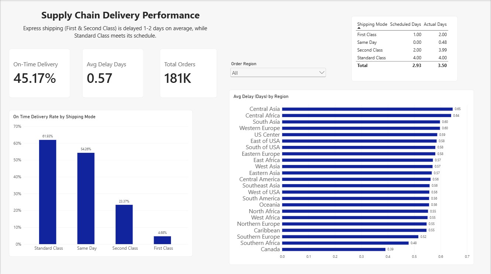

# Supply Chain Delivery Performance Dashboard

An interactive Power BI dashboard analyzing delivery performance of 181K orders.

## Dashboard

## Questions answered
1. What percentage of orders are delivered on time?
2. How many days are orders delayed on average?
3. Does delivery performance differ by region?
4. Does shipping mode affect on-time delivery?

## Key findings
- Overall on-time delivery: 45.17%
- Standard Class: 61.93% | Same Day: 54.26% | Second Class: 23.37% | First Class: 4.68%
- First Class is scheduled for 1 day but takes 2 days on average; Second Class is scheduled for 2 days but takes about 4
- Differences between regions are small (0.39 to 0.65 days)

## Recommendation
Review promised delivery times for express shipping and assess carrier performance for these modes.

## Tools
Power BI, Power Query, DAX

## Data
DataCo Smart Supply Chain for Big Data Analysis (Kaggle)
